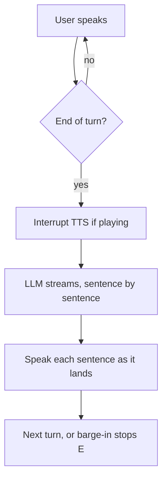

# Voice Agent

A real-time voice AI assistant pipeline: listen with a microphone, transcribe speech, run an LLM agent, and speak the reply aloud.


## Pipeline


## How it works

`main.py` owns the orchestration: it connects the transcriber, opens the mic stream, and runs an async loop that waits for each finished turn, interrupts any ongoing speech, generates the reply, and plays it.

| File       | Role                                             |
|------------|--------------------------------------------------|
| `main.py`  | Orchestrator — mic thread, turn loop, responder loop, wiring |
| `asr.py`   | Async streaming ASR over WebSocket, bounded turn queue, connect timeout |
| `llm.py`   | Agent with system prompt, tools, turn-based history, sentence streaming |
| `tts.py`   | Streaming TTS played off the event loop, interrupt (barge-in) support, tee to AEC |
| `aec.py`   | Echo cancellation — subtracts the agent's own voice from the mic |
| `tools.py` | Tool implementations: bash allowlist, read file, project tree |
| `config.py`| Model ids, voice id, sample rates, API keys      |

Turn flow:



## Tests

```bash
uv run pytest tests/test_pipeline_units.py -v   # no API keys, no audio device
```

Covers the bash allowlist, output capping, turn-based history, sentence splitting, echo
cancellation, self-echo rejection, and both barge-in paths. The latency suite needs keys
and, for a real ASR turn number, a 16 kHz mono wav via `ASR_AUDIO_FILE`.

The self-echo loop is covered offline, against a synthetic far-field echo: with AEC
off, the agent's own voice trips the VAD barge-in gate on over half of all frames and
cuts itself off mid-word; with AEC on, that falls to zero. What the tests still cannot
tell you is how well AEC performs in your actual room — that needs a speaker.

To re-tune the barge-in gate for your own mic, gain and room:

```bash
uv run python scripts/calibrate_vad.py path/to/speech.wav
```

## Verification status

_As of 2026-10-14. A snapshot, and it goes stale — re-check every row when `asr.py`,
`tts.py`, `aec.py`, `llm.py` or `config.py` changes, and treat an un-re-checked table as
evidence of nothing._

_Narrower still: every model-dependent row is valid only for the model as served on the
date measured. None of these files fire when Groq changes how `gpt-oss-20b` behaves, and
the narration and tool-call rows depend entirely on the model rather than on the code._

What each load-bearing claim rests on, and what it does not. This section exists
because four separate errors in this project were all "a number from a path the
agent does not use": the end-to-end figure that never opened a microphone, a
residual metric that could not distinguish passthrough from cancellation, a raw
TTFT probe that omitted the system prompt and tool schemas, and a counting
script that double-counted what a filter had already dropped. None were caught by
looking harder at the number. Each needed the question "what code path produced
this, and does the agent use it?"

| Claim | Rests on | Not established |
|--------|----------|-----------------|
| Echo cancellation is load-bearing | Offline test: raw synthetic echo drives the VAD gate on >50% of frames, AEC-cleaned on ~0% | Anything about a real room. Single delayed path, no reverb, no speaker |
| ASR turn ~815 ms | Live, wall-clock-paced measurement against real AssemblyAI | Generalises beyond that clip and key |
| Self-echo guard holds | Offline, up to ~30% transcription error | Echo degraded past recognition, where it cannot help at all |
| Intent-narration filter | Offline classification tests over the observed shapes | **How often narration occurs.** Unmeasured. Across varied prompts the two samples disagree (1 of 6, then 1 of 2); on a single prompt the model is *uncertain* it narrated in 4 of 5 runs, so the rate is likely highest exactly where the agent has nothing to go on. A 95% interval on 1-in-6 spans 0.4–64%, which cannot separate "occasional" from "one in three" |
| A refusal makes the model simplify | A refusal suggests a working command | **Measured as decoration.** Asked for global git config, the model tried 3, then 8, then 11 tool calls and concluded "the environment blocks `git config`" every time. It retries harder; it does not simplify. The suggestion is harmless but did not work, and the model invents an environmental explanation rather than "that is not allowed" |
| The prompt change suppresses narration | 1 usable trial on the uncertain prompt: narration suppressed, tool call made, correct answer | Also a regression, and n is too small to separate: that trial used **23 tool attempts** for one commit subject. Narration traded for tool thrash. What bounds it is `request_limit`, which caps requests, not attempts - 10 requests at ~2 parallel calls each is 20-odd attempts |
| Narration is filtered | Offline classification tests over the observed shapes | **How often narration occurs — and "rate" is the wrong frame.** It is conditional on uncertainty, not random: on a prompt the model was unsure about it narrated 4 times in 5, while across varied prompts it was 1 in 6. Averaging a mix of easy and hard prompts measures the prompt selection, not the model, so the paced 26-prompt run would produce a number that looks meaningful and is not. The open question is what the agent should *do* when uncertain, which is a design decision, not a measurement |
| Tool loops are bounded | **Behaviour, not source.** A forced loop (a function-backed model that only ever asks for another tool call) is aborted by `request_limit` within the configured number of model calls, and by `tool_calls_limit` for executions | Whether the *real* model loops on a real prompt. Five live runs of the 76 s prompt did not loop, so the live path is untested; only the brake is verified |
| The agent does not invent repository state | Prompt rule: current-state questions must call a tool first. Enforced by the prompt, which is advice to the same model | **Nothing.** A hallucinated commit subject was observed and delivered confidently, and the narration filter cannot catch it — a false answer has no promise shape. This is the largest untested weakness in the stack |
| Tool executions bounded at 6 | Our own counter inside the tool bodies | Does not shorten a turn — it only reduces subprocess work, shifting the run-length problem to `request_limit` |
| Model choice is not the latency lever | Apples-to-apples through `LLMAgent`: 379 ms vs 318 ms, crossing maxes | n=4 per model; both are inside noise of each other |

A claim here that is read from source has not been verified by behaviour, and the
one time that distinction was ignored it produced a cap that silently did
nothing.

## Known limits

- Single turn queue and single response at a time — no overlap between turns.
- Playback is interrupted by voice activity on the cleaned mic audio, so you can cut
  the agent off mid-sentence. What it *cannot* do is cut you off mid-word — the reply to
  your interruption still waits for ASR to close your turn.
- AEC needs a converged far-end reference, so the first stretch of speech after playback
  starts is the leakiest. Turns arriving inside `aec_config.warmup_ms` are dropped rather
  than trusted, which means a genuine barge-in that early is missed.
- **Testing the AEC needs loudspeakers, not headphones.** With headphones there is no echo
  path, so the agent cannot hear itself and the run collapses to "the self-echo guard
  works" — which is already covered offline. The question still open, whether AEC
  suppresses real room echo, is only answerable on a speaker-and-mic rig, and that may not
  be the machine you normally develop on.
- The self-echo guard is a similarity threshold, not an acoustic test. Say something
  close to the agent's last sentence and your turn gets dropped; raise
  `aec_config.echo_match_ratio` to be stricter.
- `asr_config.vad_threshold` and `aec_config.warmup_ms` are calibrated against one
  microphone and one room. Both are the knobs to turn if it misbehaves for you, and
  `scripts/calibrate_vad.py` measures the first from a clip.
- The self-echo guard matches on text similarity. It holds to roughly 30% transcription
  error, but echo degraded past the point where ASR recognises words at all is not
  catchable this way — that case depends entirely on AEC having removed it first.
- `find`/`grep` can stall a turn silently for up to 15 s; nothing tells the user it is
  waiting.
- Tool calls are capped at 6 per turn (`llm_config.tool_call_limit`), but a turn that
  hits the cap is a turn that mostly failed. Both models will happily loop tools —
  35 calls in 107 s was measured on `gpt-oss-20b` — so treat the cap as a floor on bad
  behaviour, not a sign the agent is working.
- Full user speech is written to logs at INFO.

See `implementation.md` for the engineering review behind these choices.

## Requirements

- Python 3.12+
- A working microphone and speaker
- API keys: AssemblyAI (STT), Groq (LLM), ElevenLabs (TTS)

## Setup

```bash
uv sync                 # or: pip install -e .
cp .env.example .env    # then fill in your API keys
```

## Run

```bash
uv run voice-agent      # or: .venv/bin/voice-agent
# or
uv run python -m voice_agent.main
```

On startup the agent speaks a hardcoded greeting, then opens the mic and starts listening. Speak into your mic. Press `Ctrl+C` to stop. Each turn is logged to the console as `user: ...` and `Assistant: ...`.

## Configuration

All model ids, the voice id, sample rates, and API keys live in `src/voice_agent/config.py`:

| Component | Default |
|-----------|---------|
| ASR | `universal-3-5-pro`, 16 kHz mic input |
| LLM | `groq:openai/gpt-oss-20b` |
| TTS | `eleven_flash_v2_5`, PCM 16 kHz output |

TTS uses raw PCM (`pcm_16000`) so audio streams straight to PyAudio without decoding.
The sample rate is deliberately the mic's 16 kHz rather than something higher: echo
cancellation needs the far-end reference at the capture rate, and matching them in config
beats resampling the reference on every audio chunk.

## Tools

The agent exposes three tools, all designed to be voice-friendly (output is truncated to ~1500 chars and summarized rather than recited):

| Tool | Backing class | Description |
|------|---------------|-------------|
| `bash_tool` | `BashTool` | Runs read-only shell commands from a fixed allowlist (`ls`, `pwd`, `cat`, `head`, `tail`, `grep`, `find`, `git`, `wc`, `echo`, `date`, `whoami`, `df`, `du`). Anything outside the allowlist is rejected. |
| `readfile_tool` | `ReadFileTool` | Reads a text file's contents (truncated) from disk. |
| `get_tree_tool` | `GetTreeTool` | Lists project files, capped at 200 entries, ignoring `.git`, `__pycache__`, `venv`, `node_modules`, etc. |

The allowlist checks more than the first word, because checking only `args[0]` made it
sound read-only while it was not:

- `git` is pinned to genuinely read-only subcommands (`status`, `log`, `diff`, `show`,
  `blame`, `describe`, `shortlog`, `ls-files`, `rev-parse`, `cat-file`, `annotate`,
  `branch`). `git push`, `git config --global` and `git log --output=file` are refused.
- `find` refuses `-delete`, `-exec`, `-execdir`, `-ok`, `-okdir` and the `-fprint`
  family, which can run commands or erase files.
- Output is read up to a 1500-byte cap and the subprocess is killed at the cap, so a
  runaway `find` cannot exhaust memory or wedge the turn. Per-command timeouts apply
  (`find` 15 s, `grep`/`git` 10 s, otherwise 5 s); on timeout the partial output so far
  is returned with "still running", because fifteen seconds of silence is
  indistinguishable from a crash.
- For `git`, only read-only subcommands are allowed *and* only the flags on an explicit
  allowlist. Blocking known-bad flags is a losing game: `--exec-path` repoints where git
  looks for its own helper programs and `--ext-diff` runs an external diff driver, both
  of which bite even after a valid subcommand.

Earlier versions also defined `WriteFileTool` and `EditFileTool`. They were never
registered and `EditFileTool` would have been an unsandboxed arbitrary-file-write, so
both were deleted rather than left armed.

## Latency

Measured by the benchmark suite (`tests/test_latency.py`); latest numbers in `reports/latency_report.md`.
Reproduce with `ASR_AUDIO_FILE=tests/sample.wav uv run pytest tests/test_latency.py -v`.

| Stage | This pipeline | Industry 2026 | Verdict |
|-------|---------------|---------------|---------|
| ASR turn (end of speech → transcript) | ~815 ms | Deepgram Nova-3 ~150 ms, AssemblyAI ~200 ms | Behind, but this is a real paced measurement — the old ~3.8 s figure was an artifact of firing the whole clip at once |
| LLM time-to-first-token (Groq `gpt-oss-20b`) | ~798 ms p50 | Groq typically sub-200–300 ms for short outputs | Reasoning-token overhead dominates; `gpt-oss-20b` thinks before it answers. Run-to-run spread is large (428–1539 ms) |
| TTS first audio chunk (ElevenLabs Flash) | ~227 ms p50 | 100–250 ms standard; premium neural voices 250–500 ms | Healthy, mid-pack |
| End-to-end (end of speech → audio) | ~1.9 s serial sum | Vapi ~720 ms p50/1050 ms p95, Retell ~680/920 ms, Bland ~850/1180 ms, Twilio ConversationRelay ~491/713 ms | Behind the fastest cascaded platforms |

The end-to-end figure is a **serial sum of separately measured stages**, not a live
speech-to-speech measurement — there is no mic or speaker in the harness. It is also an
upper bound: the real pipeline now overlaps stages, and a sum cannot show that.

Two honest caveats about where the remaining time goes:

- **Sentence streaming buys little here, for a specific reason.** Groq does stream
  incrementally — a longer prompt produced 185 separate text deltas — so this is not a
  wrapper hiding the stream. The cost is that `gpt-oss-20b` is a *reasoning* model: it
  emits 40–90 reasoning tokens before any speakable text, and `stream_text` correctly
  withholds reasoning from the text stream. For the 1–3 sentence replies this agent's
  system prompt asks for, the visible answer is ~8 tokens arriving right after the
  reasoning ends, so there is no interval left to chunk.

  Swapping to a non-reasoning model was tried and reverted. A raw `stream=True` probe
  promised a large win (587 ms → 207 ms to first text), but measured through
  `LLMAgent` the same comparison is 379 ms → 318 ms with crossing maxes. The probe
  omits the system prompt and the three tool schemas, and that prefill dominates.
  Groq's model catalog also varies by key tier — `llama-3.3-70b-versatile` 404s on the
  key this was developed against — so measure through the agent, not the raw endpoint,
  before trusting any model-swap number.
- **The concurrency fixes do not show up in these numbers at all**, because the harness
  sums stages instead of running them together. What they buy is barge-in: the agent can
  now be interrupted mid-sentence instead of finishing first.

## Benchmark

```bash
ASR_AUDIO_FILE=tests/sample.wav uv run pytest tests/test_latency.py -v   # requires API keys
.venv/bin/python scripts/generate_latency_report.py
```
