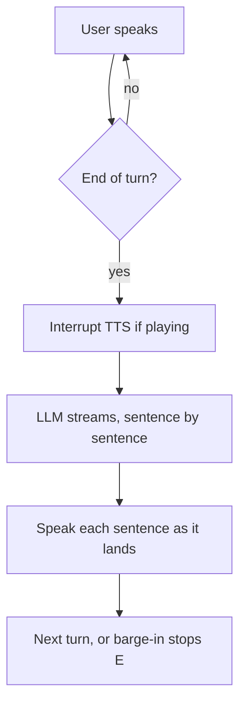

# Voice Agent

A real-time voice AI assistant pipeline: listen with a microphone, transcribe speech, run an LLM agent, and speak the reply aloud.

## Pipeline


## How it works

`main.py` owns the orchestration: it connects the transcriber, opens the mic stream, and runs an async loop that waits for each finished turn, interrupts any ongoing speech, generates the reply, and plays it.

| File       | Role                                             |
|------------|--------------------------------------------------|
| `main.py`  | Orchestrator — mic thread, turn loop, responder loop, wiring |
| `asr.py`   | Async streaming ASR over WebSocket, bounded turn queue, connect timeout |
| `llm.py`   | Agent with system prompt, tools, turn-based history, sentence streaming |
| `tts.py`   | Streaming TTS played off the event loop, interrupt (barge-in) support, tee to AEC |
| `aec.py`   | Echo cancellation — subtracts the agent's own voice from the mic |
| `tools.py` | Tool implementations: bash allowlist, read file, project tree |
| `config.py`| Model ids, voice id, sample rates, API keys      |

Turn flow:



## Tests

```bash
uv run pytest tests/test_pipeline_units.py -v   # no API keys, no audio device
```

Covers the bash allowlist, output capping, turn-based history, sentence splitting, echo
cancellation, self-echo rejection, and both barge-in paths. The latency suite needs keys
and, for a real ASR turn number, a 16 kHz mono wav via `ASR_AUDIO_FILE`.

None of these tests can prove the echo cancellation works. They cover the plumbing
around it; whether AEC actually cancels depends on the room, and that needs a human with
a speaker.

## Known limits

- Single turn queue and single response at a time — no overlap between turns.
- Playback is interrupted by voice activity on the cleaned mic audio, so you can cut
  the agent off mid-sentence. What it *cannot* do is cut you off mid-word — the reply to
  your interruption still waits for ASR to close your turn.
- AEC needs a converged far-end reference, so the first stretch of speech after playback
  starts is the leakiest. Turns arriving inside `aec_config.warmup_ms` are dropped rather
  than trusted, which means a genuine barge-in that early is missed.
- The self-echo guard is a similarity threshold, not an acoustic test. Say something
  close to the agent's last sentence and your turn gets dropped; raise
  `aec_config.echo_match_ratio` to be stricter.
- `asr_config.vad_threshold` and `aec_config.warmup_ms` are calibrated against one
  microphone and one room. Both are the knobs to turn if it misbehaves for you.
- `find`/`grep` can stall a turn silently for up to 15 s; nothing tells the user it is
  waiting.
- Tool calls can push a turn to tens of seconds, far past anything the latency table
  suggests.
- Full user speech is written to logs at INFO.

See `implementation.md` for the engineering review behind these choices.

## Requirements

- Python 3.12+
- A working microphone and speaker
- API keys: AssemblyAI (STT), Groq (LLM), ElevenLabs (TTS)

## Setup

```bash
uv sync                 # or: pip install -e .
cp .env.example .env    # then fill in your API keys
```

## Run

```bash
uv run voice-agent      # or: .venv/bin/voice-agent
# or
uv run python -m voice_agent.main
```

On startup the agent speaks a hardcoded greeting, then opens the mic and starts listening. Speak into your mic. Press `Ctrl+C` to stop. Each turn is logged to the console as `user: ...` and `Assistant: ...`.

## Configuration

All model ids, the voice id, sample rates, and API keys live in `src/voice_agent/config.py`:

| Component | Default |
|-----------|---------|
| ASR | `universal-3-5-pro`, 16 kHz mic input |
| LLM | `groq:openai/gpt-oss-20b` |
| TTS | `eleven_flash_v2_5`, PCM 16 kHz output |

TTS uses raw PCM (`pcm_16000`) so audio streams straight to PyAudio without decoding.
The sample rate is deliberately the mic's 16 kHz rather than something higher: echo
cancellation needs the far-end reference at the capture rate, and matching them in config
beats resampling the reference on every audio chunk.

## Tools

The agent exposes three tools, all designed to be voice-friendly (output is truncated to ~1500 chars and summarized rather than recited):

| Tool | Backing class | Description |
|------|---------------|-------------|
| `bash_tool` | `BashTool` | Runs read-only shell commands from a fixed allowlist (`ls`, `pwd`, `cat`, `head`, `tail`, `grep`, `find`, `git`, `wc`, `echo`, `date`, `whoami`, `df`, `du`). Anything outside the allowlist is rejected. |
| `readfile_tool` | `ReadFileTool` | Reads a text file's contents (truncated) from disk. |
| `get_tree_tool` | `GetTreeTool` | Lists project files, capped at 200 entries, ignoring `.git`, `__pycache__`, `venv`, `node_modules`, etc. |

The allowlist checks more than the first word, because checking only `args[0]` made it
sound read-only while it was not:

- `git` is pinned to genuinely read-only subcommands (`status`, `log`, `diff`, `show`,
  `blame`, `describe`, `shortlog`, `ls-files`, `rev-parse`, `cat-file`, `annotate`,
  `branch`). `git push`, `git config --global` and `git log --output=file` are refused.
- `find` refuses `-delete`, `-exec`, `-execdir`, `-ok`, `-okdir` and the `-fprint`
  family, which can run commands or erase files.
- Output is read up to a 1500-byte cap and the subprocess is killed at the cap, so a
  runaway `find` cannot exhaust memory or wedge the turn. Per-command timeouts apply
  (`find` 15 s, `grep`/`git` 10 s, otherwise 5 s); on timeout the partial output so far
  is returned with "still running", because fifteen seconds of silence is
  indistinguishable from a crash.
- For `git`, only read-only subcommands are allowed *and* only the flags on an explicit
  allowlist. Blocking known-bad flags is a losing game: `--exec-path` repoints where git
  looks for its own helper programs and `--ext-diff` runs an external diff driver, both
  of which bite even after a valid subcommand.

Earlier versions also defined `WriteFileTool` and `EditFileTool`. They were never
registered and `EditFileTool` would have been an unsandboxed arbitrary-file-write, so
both were deleted rather than left armed.

## Latency

Measured by the benchmark suite (`tests/test_latency.py`); latest numbers in `reports/latency_report.md`.
Reproduce with `ASR_AUDIO_FILE=tests/sample.wav uv run pytest tests/test_latency.py -v`.

| Stage | This pipeline | Industry 2026 | Verdict |
|-------|---------------|---------------|---------|
| ASR turn (end of speech → transcript) | ~815 ms | Deepgram Nova-3 ~150 ms, AssemblyAI ~200 ms | Behind, but this is a real paced measurement — the old ~3.8 s figure was an artifact of firing the whole clip at once |
| LLM time-to-first-token (Groq `gpt-oss-20b`) | ~798 ms p50 | Groq typically sub-200–300 ms for short outputs | Reasoning-token overhead dominates; `gpt-oss-20b` thinks before it answers. Run-to-run spread is large (428–1539 ms) |
| TTS first audio chunk (ElevenLabs Flash) | ~227 ms p50 | 100–250 ms standard; premium neural voices 250–500 ms | Healthy, mid-pack |
| End-to-end (end of speech → audio) | ~1.9 s serial sum | Vapi ~720 ms p50/1050 ms p95, Retell ~680/920 ms, Bland ~850/1180 ms, Twilio ConversationRelay ~491/713 ms | Behind the fastest cascaded platforms |

The end-to-end figure is a **serial sum of separately measured stages**, not a live
speech-to-speech measurement — there is no mic or speaker in the harness. It is also an
upper bound: the real pipeline now overlaps stages, and a sum cannot show that.

Two honest caveats about where the remaining time goes:

- **Sentence streaming buys little here, for a specific reason.** Groq does stream
  incrementally — a longer prompt produced 185 separate text deltas — so this is not a
  wrapper hiding the stream. The cost is that `gpt-oss-20b` is a *reasoning* model: it
  emits 40–90 reasoning tokens before any speakable text, and `stream_text` correctly
  withholds reasoning from the text stream. For the 1–3 sentence replies this agent's
  system prompt asks for, the visible answer is ~8 tokens arriving right after the
  reasoning ends, so there is no interval left to chunk. Switching to a non-reasoning
  model would put text on the wire immediately and is the lever worth pulling if first
  audio ever matters more than answer quality. Note that Groq model catalogs differ by
  key tier — `llama-3.3-70b-versatile` 404s on the key this was developed against, so
  check what your own key can actually reach before planning around a model swap.
- **The concurrency fixes do not show up in these numbers at all**, because the harness
  sums stages instead of running them together. What they buy is barge-in: the agent can
  now be interrupted mid-sentence instead of finishing first.

## Benchmark

```bash
ASR_AUDIO_FILE=tests/sample.wav uv run pytest tests/test_latency.py -v   # requires API keys
.venv/bin/python scripts/generate_latency_report.py
```