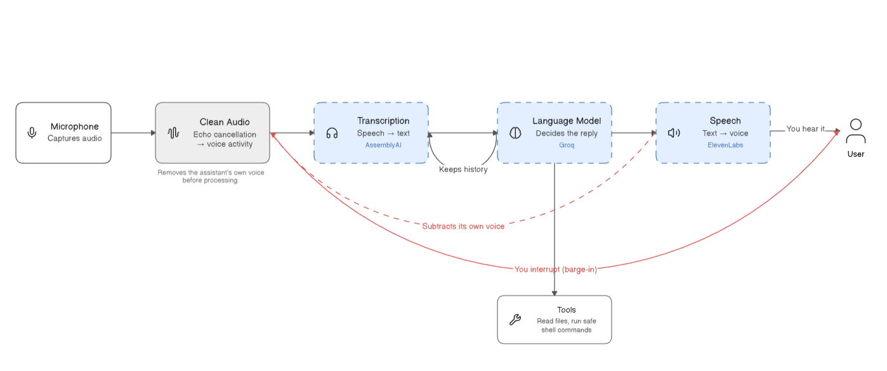

# Voice Agent

A real-time voice assistant. Speak, it transcribes, runs a tool-calling LLM agent, and speaks the reply. Streaming end to end, with barge-in.



## Quickstart

Needs Python 3.12+, a working microphone and speaker, and API keys for Deepgram (STT), Groq (LLM) and ElevenLabs (TTS).

```bash
uv sync                 # or: pip install -e .
cp .env.example .env    # then fill in your API keys
uv run voice-agent      # or: .venv/bin/voice-agent
```

The agent speaks a greeting, opens the mic and starts listening. Each turn is logged to the console as `user: ...` / `Assistant: ...`. `Ctrl+C` to stop.

## How it works

`main.py` owns the orchestration: it connects the transcriber, opens the mic stream, and runs an async loop that waits for each finished turn, interrupts any speech in progress, generates the reply and plays it.

| File | Role |
|------|------|
| `main.py` | Orchestrator — mic thread, turn loop, responder loop, wiring |
| `asr.py` | Async streaming ASR over WebSocket, bounded turn queue, connect timeout |
| `llm.py` | Agent with system prompt, tools, turn-based history, sentence streaming |
| `tts.py` | Streaming TTS played off the event loop, interrupt (barge-in) support, tee to AEC |
| `aec.py` | Echo cancellation — subtracts the agent's own voice from the mic |
| `tools.py` | Tool implementations: bash allowlist, read file, project tree |
| `config.py` | Model ids, voice id, sample rates, API keys |

A turn runs end of speech → transcription → the LLM streams sentence by sentence → each sentence plays as it lands. Voice activity during playback cuts the audio off instead of waiting for the sentence to finish; the reply to that interruption still waits for ASR to close your turn, so it can cut the agent off mid-sentence but not you mid-word.

## Configuration

All model ids, the voice id, sample rates and API keys live in `src/voice_agent/config.py`:

| Component | Default |
|-----------|---------|
| ASR | `nova-2`, 16 kHz mic input |
| LLM | `qwen/qwen3.8-27b` |
| TTS | `eleven_flash_v2_5`, PCM 16 kHz output |

TTS uses raw PCM (`pcm_16000`) so audio streams straight to PyAudio without decoding. The sample rate is deliberately the mic's 16 kHz rather than something higher: echo cancellation needs the far-end reference at the capture rate, and matching them in config beats resampling the reference on every audio chunk.

## Tools

Three tools, all voice-friendly — output is truncated to ~1500 chars and summarized rather than recited.

| Tool | Backing class | Description |
|------|---------------|-------------|
| `bash_tool` | `BashTool` | Read-only shell commands from a fixed allowlist (`ls`, `pwd`, `cat`, `head`, `tail`, `grep`, `find`, `git`, `wc`, `echo`, `date`, `whoami`, `df`, `du`). |
| `readfile_tool` | `ReadFileTool` | Reads a text file's contents (truncated) from disk. |
| `get_tree_tool` | `GetTreeTool` | Lists project files, capped at 200 entries, ignoring `.git`, `__pycache__`, `venv`, `node_modules`. |

The allowlist checks more than the first word, because checking only `args[0]` made it sound read-only while it was not:

- `git` is pinned to genuinely read-only subcommands (`status`, `log`, `diff`, `show`, `blame`, `describe`, `shortlog`, `ls-files`, `rev-parse`, `cat-file`, `annotate`, `branch`) **and** to flags on an explicit allowlist. Blocking known-bad flags alone is a losing game — `--exec-path` repoints where git looks for its own helper programs and `--ext-diff` runs an external diff driver, both of which bite even after a valid subcommand. `git push`, `git config --global` and `git log --output=file` are refused.
- `find` refuses `-delete`, `-exec`, `-execdir`, `-ok`, `-okdir` and the `-fprint` family, which can run commands or erase files.
- Output is read up to a 1500-byte cap and the subprocess is killed at the cap, so a runaway `find` cannot exhaust memory or wedge the turn. Per-command timeouts apply (`find` 15 s, `grep`/`git` 10 s, otherwise 5 s); on timeout the partial output so far is returned with "still running", because fifteen seconds of silence is indistinguishable from a crash.

`WriteFileTool` and `EditFileTool` existed briefly and were deleted — never registered, and `EditFileTool` would have been an unsandboxed arbitrary-file-write.

## Latency

Measured by the benchmark suite. Full numbers, including the ones not shown here, are in `reports/latency_report.md`.

| Stage | Model | Median | Samples |
|-------|-------|--------|---------|
| ASR turn (end of speech → transcript) | `nova-2` (estimated) | ~300 ms | TBD |
| LLM time-to-first-token | `qwen/qwen3.8-27b` | 798 ms | 5 |
| TTS first audio chunk | `eleven_flash_v2_5` | 227 ms | 5 |
| Serial sum, end of speech → audio | — | ~1.33 s (estimated) | TBD |

Read these with their limits attached:

- Every row is one stage timed on its own, then added up. The harness opens no microphone and plays through no speaker, so no row here describes a real conversation. The serial sum is an upper bound — the live pipeline overlaps stages, and a sum cannot show that.
- The `e2e_first_audio` metric exists but is not reported. The Groq key is rate limited to 8000 tokens/min, and the doubled call volume produced multi-second outliers that dominate the mean.
- ASR figures are estimates for Deepgram nova-2. Actual benchmarks need to be re-run.
- `qwen/qwen3.8-27b` is a reasoning model: it emits reasoning tokens before any speakable text, and that is most of the 798 ms. Swapping to a non-reasoning model was tried and did not help. A raw `stream=True` probe promised 587 ms → 207 ms, but measured through `LLMAgent` with the system prompt and all three tool schemas attached, the same comparison is 379 ms vs 318 ms with crossing maxes (n=4). Prefill dominates, so measure through the agent, not the raw endpoint.

## Testing

```bash
uv run pytest tests/test_pipeline_units.py -v   # no API keys, no audio device
```

92 tests, no network: bash allowlist, output capping, turn-based history, sentence splitting, echo cancellation, self-echo rejection, and both barge-in paths.

The self-echo loop is covered offline against a synthetic far-field echo. With AEC off, the agent's own voice trips the VAD barge-in gate on over half of all frames and cuts itself off mid-word; with AEC on, that falls to zero. What the tests cannot tell you is how AEC performs in your actual room — that needs a speaker.

To re-tune the barge-in gate for your own mic, gain and room:

```bash
uv run python scripts/calibrate_vad.py path/to/speech.wav
```

## Known limits

- Single turn queue, single response at a time — no overlap between turns.
- Playback is interrupted by voice activity on the cleaned mic audio, so you can cut the agent off mid-sentence. It cannot cut you off mid-word — the reply to your interruption still waits for ASR to close your turn.
- AEC needs a converged far-end reference, so the first stretch of speech after playback starts is the leakiest. Turns arriving inside `aec_config.warmup_ms` are dropped rather than trusted, which means a genuine barge-in that early is missed.
- Testing AEC needs loudspeakers, not headphones. With headphones there is no echo path and the run collapses to "the self-echo guard works" — already covered offline. Whether AEC suppresses real room echo is only answerable on a speaker-and-mic rig.
- The self-echo guard is a text-similarity threshold, not an acoustic test. Say something close to the agent's last sentence and your turn gets dropped; raise `aec_config.echo_match_ratio` to be stricter. It holds to roughly 30% transcription error, but echo degraded past the point where ASR recognises words at all is not catchable this way — that case depends entirely on AEC having removed it first.
- `asr_config.vad_threshold` and `aec_config.warmup_ms` are calibrated against one microphone and one room. They are the knobs to turn if it misbehaves for you, and `scripts/calibrate_vad.py` measures the first from a clip.
- `find`/`grep` can stall a turn silently for up to 15 s; nothing tells the user it is waiting.
- Tool calls are capped at 6 per turn (`llm_config.tool_call_limit`), but a turn that hits the cap is a turn that mostly failed. `gpt-oss-20b` will happily loop tools — 35 calls in 107 s was measured — so treat the cap as a floor on bad behaviour, not a sign the agent is working.
- Full user speech is written to logs at INFO.

## What we measured

Five claims this project actually tested, and what they don't cover:

- **Echo cancellation is load-bearing.** A raw synthetic echo drives the VAD barge-in gate on >50% of frames; AEC-cleaned, on ~0%. Tested against a single delayed path — no reverb, no real speaker.
- **Tool loops are bounded.** A model stubbed to only ever ask for another tool call is aborted within the configured number of calls, by `request_limit` on model calls and `tool_calls_limit` on executions. Five live runs of the 76 s prompt never looped, so the live path is still untested — only the brake is verified.
- **Model choice is not the latency lever.** Apples-to-apples through `LLMAgent`: 379 ms vs 318 ms with crossing maxes. n=4 per model, and both sit inside each other's noise.
- **A refusal does not make the model simplify.** Asked for a global git config, it tried 3, then 8, then 11 tool calls and concluded "the environment blocks `git config`" every time. It retries harder and invents an environmental explanation rather than saying "that is not allowed".
- **The agent does invent repository state.** A hallucinated commit subject was observed and delivered confidently, and the narration filter cannot catch it — a false answer has no promise shape to match on. It is enforced only by a prompt rule advising the same model that could violate it. This is the largest untested weakness in the stack.

Reproduce the latency numbers with:

```bash
ASR_AUDIO_FILE=tests/sample.wav uv run pytest tests/test_latency.py -v   # requires API keys
.venv/bin/python scripts/generate_latency_report.py
```